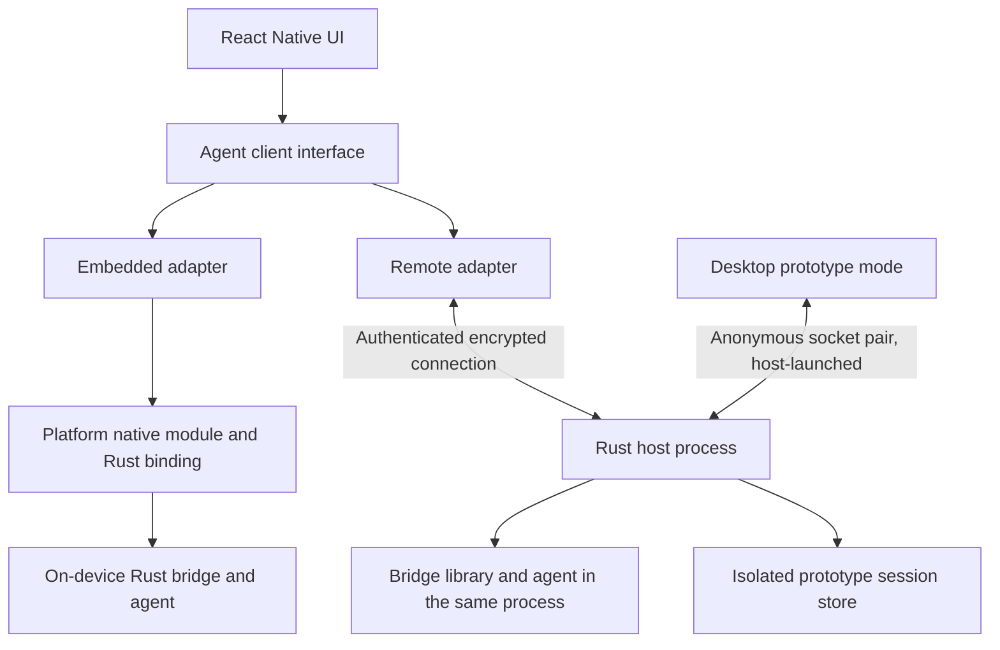

# Mobile architecture and security

This is a high-level starting plan, not an exhaustive account of edge cases or behavior. Expect implementation discoveries to change or add to it. Update the affected design, specs, and tests as those decisions are made; resolve security gaps before enabling the affected feature. See the [executive summary](executive-summary.md) for the full proposal in one document.

## Execution targets

Use React Native for the mobile UI and one TypeScript session interface with embedded and remote adapters. Prove the interface first with a client on the local host machine driving the existing stdio RPC process, with a bounded embedded exercise proceeding independently of the host track.

Every session belongs to one execution target. Keep the target visible in the session list, composer, and approval views. Switching targets selects or creates another session; it never moves live execution, copies permission grants, reinterprets paths, or falls back to executing on another device.

Agent execution and model inference are separate choices. An agent on the phone may call a remote model service. Neither offline operation nor on-device inference is promised. Sessions, tasks, targets, and capabilities are the common vocabulary; Git projects and coding tools are capabilities rather than assumptions about every future mobile task.

## React Native and embedded execution

Put thin TypeScript adapters, wire types, client-local UI state, and fixtures in the standalone `packages/agent-client/` package. Shared session behavior, approval semantics, and reusable presentation transforms live in Rust and reach both execution modes through the [shared view contract](client-contract.md#shared-screen-state). The TypeScript package's build and local test program run independently of the desktop app. React Native consumes that package directly; desktop integration comes later, in stage 5b. Keep Node, DOM, Electron, and JNI APIs outside that shared library. Use the existing WebView layouts and interactions to inform native views; React DOM/CSS components need adaptation for React Native.

Use React Native for native mobile controls and shared Android/iOS screens. The [UI decision](decisions-and-tradeoffs.md#1-react-native-for-both-mobile-modes) records the alternatives and requires device validation of responsiveness, input, scrolling, accessibility, approval display, and lifecycle handling before expanding the screens. Neither platform has delivery priority; select the first device proof based on integration effort and available hardware, and track tested platform coverage.

A narrow React Native native module reaches the Rust runtime through a platform binding. Android can start from the Rust/JNI binding on the unmerged [android-shell](https://github.com/brave/bravebot/tree/android-shell) branch (see [Current mobile status](README.md#current-mobile-status)). Stage 2b adds native integration coverage. iOS needs a separate binding. Typed native-module specifications and platform bindings provide the integration mechanism, not an existing Bravebot adapter. See [React Native native modules](https://reactnative.dev/docs/turbo-native-modules-introduction).

The embedded proof is foreground-only: one session, app-private storage, a turn, and one supported question or approval. Test denial, cancellation, and labelled presentation on that path. Audit existing tools to choose it; missing command confinement must continue to refuse commands. Do not add a phone network server or desktop command parity to satisfy the common interface.

Start the embedded runtime only for an explicitly selected on-device session. Remote-only use must not start it. Device credentials and state remain separate from paired-host credentials. Runtime teardown must explicitly stop/refuse pending work; losing a JavaScript listener alone does not prove execution stopped. After app/runtime loss, report interruption or uncertainty without replaying effects. Broader device tools and background services are later work. Passing on one platform does not establish support on the other.

## Rust sharing boundary

Reuse the existing Rust crates for execution, permissions, model-provider access, session lifecycle, and projection. The local proof needs only the view of its supported events; recovery and shared control arrive in later stages. The [client contract](client-contract.md#shared-screen-state) defines the additive view capability, compatibility behavior, and thin TypeScript adapters. Transport validation can reject malformed input early; the execution owner enforces policy.

Keep inspection of released content in a separate presentation layer permitted by [LAYER-1](../../specs/layering.md#LAYER-1). The bridge is currently a non-presentation crate that carries labelled payloads without inspecting them. The proposed session projection must preserve that boundary. Reuse suitable Rust presentation helpers or extract a narrow presentation crate with its first caller and required spec changes. Do not put content inspection in bridge dispatch, `bravebot-core`, or `bravebot-agent`. Presentation outputs are for display and cannot determine execution or enter planner input.

The first block uses `crates/ui-bridge/src/view.rs` for opaque row/status projection and the
existing emitter for ordered publication. It reuses `wire.rs` for accepted prompt tags and the
existing confirmer for approval decisions. No dependency or presentation crate is added:
`bravebot-cli::progress::printable` and the TUI marking helpers inspect released text and draw
terminal-specific output, which this transport does not need. Extract display transforms with
the first rendering caller. The [normative view spec](../../specs/session-view.md) and the real
stdio tests in `crates/ui-bridge/tests/fetch.rs` cover this boundary. Native marking remains untested.

## Embedded model credentials

The first embedded proof uses a controlled model stub and needs no production credential. Before enabling a real backend on a phone, add a native credential provider to the existing Rust backend/configuration path, governed by [backends](../../specs/backends.md) and [credential protection](../../specs/credential-protection.md). Extend that path instead of implementing model authentication or requests in JavaScript. Mobile storage is proposed work; existing desktop credential files do not establish it.

For the first real-backend exercise, support one explicitly configured gateway and a separately issued, revocable credential entered by the person on that phone. Bind it to the confirmed endpoint; changing the endpoint requires new confirmation and credential setup. No host credential transfer, credential in an app bundle, or import from a chat or workspace. Other backend login flows wait until they have their own supported mobile path.

Keep credential values out of JavaScript state and process-wide environment variables. Return only an opaque configuration ID and status to the UI, and supply the secret directly to Rust for the intended backend request. Preserve the Rust credential-buffer protections and refuse real-backend use where the platform cannot meet the governing requirements.

Native secure entry, the storage settings below, device authentication, and stopping embedded work on lock/background are the initial design to test under [Q3](open-questions.md#q3-how-are-embedded-api-keys-set-up-stored-and-revoked-after-device-loss). Their mechanisms are provisional. Device evidence may justify a different mechanism that meets the same secret-protection requirements and the foreground-only prototype scope. Record the choice and update the affected lifecycle checks before enabling real credentials. Until then, use the controlled model stub.

- **iOS:** use a non-synchronizing Keychain item with `kSecAttrAccessibleWhenPasscodeSetThisDeviceOnly`. It requires a passcode and unlocked device and does not migrate to another device. See [Apple's accessibility rules](https://developer.apple.com/documentation/security/ksecattraccessiblewhenpasscodesetthisdeviceonly).
- **Android:** encrypt the credential in app-private storage with a non-exportable [Android Keystore](https://developer.android.com/privacy-and-security/keystore) key requiring device authentication. Exclude the encrypted record from backup and device transfer. Treat invalidated keys or unavailable secure storage as requiring setup again, with no plaintext fallback. The Keystore protects the encryption key; the model credential must still enter Rust memory when used.
- **Lifecycle:** stop embedded work on lock/background, refuse pending questions, and clear owned credential buffers on teardown. Do not store secrets in transcripts, snapshots, logs, crash reports, URLs, or pending-send records. [React Native's security guidance](https://reactnative.dev/docs/security) identifies Async Storage as unencrypted and unsuitable for secrets.
- **Removal and loss:** provide a local remove action that stops affected work and deletes the stored credential. Reuse Rust's credential-revocation record for the issuer, exact external revocation route, and any derived credentials that survive revocation, as CRED-25 requires. Local deletion and uninstall do not revoke a provider key. After device loss, revoke it at the provider and separately revoke host pairing on the host; neither action substitutes for the other. Do not promise remote erasure of content already on the phone.

Keep model credentials and pairing credentials in separate records and APIs. Remote-only mode uses host pairing without reading the phone's model credentials. Before a real-backend demo, test lock/relaunch, invalidation, deletion, backup/restore, endpoint changes, separation from pairing, and exclusion from captured logs and planner requests using test credentials. Record provider-side revocation evidence separately from local deletion.

## iOS capability and distribution limits

**Remote control:** the agent and tools execute on the user's host. The phone's iOS sandbox does not constrain tool execution on that host; host permissions, command confinement, pairing, and session authorization still apply. The phone client remains subject to iOS rules for its own storage, networking, and lifecycle.

**On-device agent:** the agent and tools execute on the phone and must respect the iOS sandbox and applicable platform rules. The first iOS embedded target is a foreground app with a Rust runtime, an app-private workspace, and a small set of compiled-in tools. For this on-device proof, exclude shell commands, downloaded executables, package installation, and arbitrary filesystem access. These exclusions do not limit tools running on the remote host. An unsupported tool returns a defined refusal. A model call may use the network; neither a local model nor desktop tool parity is required. The OS sandbox remains binding in development builds: [Apple's runtime security guide](https://support.apple.com/en-gb/guide/security/sec15bfe098e/web) limits cross-app access to platform-provided services.

Apple's [App Review Guidelines](https://developer.apple.com/app-store/review/guidelines/) constrain downloaded/executed code in 2.5.2 and background services in 2.5.4. TestFlight also requires guideline compliance under 2.2. These are constraints to check against the enabled tools, not evidence that this app will be accepted. Start hardware proofs with developer-installed builds and record the distribution method. Before TestFlight or App Store submission, review the actual tool list, entitlements, third-party SDKs, privacy disclosures, and backend/account flow against the current rules.

Remote mode needs a separate distribution check too. Guideline 4.2.7 includes a LAN restriction for certain remote desktop clients. Whether this session-control app falls within it needs review before promising App Store distribution of away-from-home control. Do not assume a remote-only build settles that question. If an embedded capability or distribution route remains unsupported, publish the narrower tested capability matrix and keep that milestone incomplete. The local host/client work can proceed independently. These platform references were checked on 5 October 2026; check the current rules again before distribution.

## Host topology decision

The persistent host is one Rust process that owns the bridge library and serves its local clients over anonymous socket pairs it creates when it launches them. The phone's network listener is a separate, named endpoint decided in [decision 15](decisions-and-tradeoffs.md#15-the-host-listens-on-one-chosen-address) and not built. The entry point is `bravebot-host` beside the existing stdio transport in `crates/ui-bridge` ([local-host.md](../../specs/local-host.md)), which preserves the stdio behavior for direct clients. The person starts a client again by typing `launch` and its name on the host's input, because a client cannot ask the host for one without a name to ask at.

The listener, session registry, display projection, and bridge share that process. There is no separate supervisor wrapping an RPC child. This removes child replacement, uncertain child liveness, and a second execution generation from the prototype. A host-instance ID changes on every host restart. Embedded runtimes have their own instance identity.

A host crash interrupts its live sessions and connection handling together. Restart does not claim continuation of in-flight work or undo completed effects. The agent may still start tool processes; removing the RPC child does not remove tool shutdown responsibilities. Use existing cancellation/confinement behavior and report unresolved effects honestly.

Initially use a foreground process whose local clients it launches itself over anonymous socket pairs; it has no named local endpoint (see [local control boundary](#local-control-boundary)). Keep session dispatch independent of transport so a development transport can support the stage-3d phone experiment. Later add authenticated encrypted networking to the same owner. Network loss must not end the host; automatic service startup and recovery are optional follow-ons. Reflect the new listener and presentation responsibilities in the layering spec alongside implementation.

## Local control boundary

A named local endpoint (a socket path, a port, a token in a file) is reachable by any program running as the same user, including an unconfined command approved through Bravebot and a process either left running after its parent exited. Directory permissions, peer credentials and process ancestry do not tell that program from a client, and a secret the client must keep somewhere the program can read does not either.

The local channel therefore has no name. The launcher creates an anonymous socket pair and starts a program it chose from the person's own configuration with one end as its standard input and output, and no other process holds either end ([RPCVIEW-8](../../specs/session-view.md#RPCVIEW-8), `crates/ui-bridge/src/control_link.rs`). The host starts every local client this way, and a client that exits ends its channel; a replacement is a new launch with a new pair. The stdio RPC process is already this arrangement when its launcher uses a socket pair, as Node does.

The cost is that a program the host did not launch cannot attach to a running host. Stage 5a's second client is launched by the host. The desktop app attaching to a host that outlives it needs a separate decision (see the [end goal](implementation-plan.md#end-goal-beyond-the-prototype)). The named listener stays disabled. A named endpoint authenticated by a code or key was tried and not adopted, because a program can replace the socket path and relay a client's proof, and a revoked key kept working on connections already open.

The boundary holds only while the tool paths hand tools no descriptor of the channel; the lock that keeps channel creation apart from program starts, and its cost, are [decision 10](decisions-and-tradeoffs.md#10-one-process-wide-spawn-gate-before-the-host-exists). The hook and `run` paths do not, and `tests/control_boundary.rs` starts both, leaves a detached process running, and checks that it holds no socket, reaches no channel, changes nothing the client reads, and does not stop the client's answer from being the one that counts. A second test in the same file holds the near ends of several channels in the process that starts the hook and the `run` program, which is the persistent host's arrangement, and checks that the programs hold none; a third does the same for an MCP server. `bravebot-rpc`, `bravebot-acp` and `bravebot-host` mark every descriptor they were started with, other than standard input, output and error, close-on-exec at startup, and a fourth test starts `bravebot-rpc` holding a socket and checks that a hook and an approved command do not receive it. The same detached-process attack runs against `bravebot-host`, which holds the near end in its own process and gives the far end to a client it started. Launchers have two obligations. Create channels and start programs under `bravebot_sandbox::process::starting_a_program`, which the agent's own starts already use (macOS sets close-on-exec in a second step, and a process started in between inherits the descriptors and the bridge passes them to its tools). And use a socket pair, because on Linux a pipe can be reopened by path. On Linux the bridge also marks itself non-dumpable so that a detached process of the same user cannot copy its descriptors with `pidfd_getfd` or `ptrace`; CI runs the attack on Linux with `ptrace_scope` 0, where the test fails unless the bridge and the host refuse it to the process a hook leaves running. The network listener does not inherit this decision: it is a named endpoint, so [decision 14](decisions-and-tradeoffs.md#14-a-device-pairs-by-a-qr-code-on-the-host-and-a-code-typed-on-the-host) decides how it authenticates. Windows is not covered. Do not claim that approval of one command authorizes future session control. General same-user malware resistance, including a debugger on macOS, is not a prototype claim.

## Session storage and ownership

Use an isolated prototype session store, separate from ordinary desktop/terminal session discovery and resumption. Use a host-startup override for the sessions root only, covering session list/load/save paths; keep settings, trust stores, and credentials at their normal locations. Amend the sessions spec alongside that implementation. Introduce this explicit storage boundary; do not casually change `HOME`, which also affects credentials, settings, and tools. The desktop prototype mode accesses these sessions only through the host. Disable saved-record import and direct open-by-path in the prototype API. Resuming a record restores its additional directories and trusted-program grants, so adding import later needs its own scope review.

Isolation is a release condition before desktop integration, not a UI convention. Test that normal supported desktop/terminal list and resume paths cannot open a host-owned prototype record, including an explicitly supplied record ID. If the chosen storage boundary cannot enforce this, add cooperating exclusion to all supported writers before proceeding. Do not ship a shared-store design with only a warning not to resume elsewhere. This protects supported front ends; it does not claim isolation from malicious code running as the same OS user.

Within the host, one registry maps target-qualified live IDs to existing bridge handles. Repeated attachment finds the same live session. A record ID is not evidence that saving succeeded: `Handle::save` currently returns no success result. Keep saved progress unknown unless independently confirmed; recover only records actually present after restart, and only if later resumption is supported.

Separate detach, cancel, and close. Detach removes a client subscription. Cancel targets an exact turn. Close acknowledges `closing`; only confirmed worker termination establishes `closed`. Save outcome remains unknown unless separately confirmed; a `finished` flag or final event alone is not worker-completion evidence. Retain ownership until that point or confirmed process exit. If completion cannot be established, refuse a replacement writer. Cancellation never implies rollback.

## Shared control across devices

Every client attached to a session receives the same view, approval requests included, except that a paired device receives the allowlisted events of [decision 19](decisions-and-tradeoffs.md#19-a-paired-device-is-an-approved-screen-that-receives-an-allowlist-of-events), and may send, answer and cancel at any time. There is no controller role, takeover step or controller epoch. From stage 6, a device whose pairing grants read only sees the view and cannot open a session, send, answer, cancel or close. [Decision 5](decisions-and-tradeoffs.md#5-every-attached-device-can-act-with-no-takeover-step) records the reasons and the deferred confirmation dialog. A session has no controller ([HOST-7](../../specs/local-host.md#HOST-7)).

The host applies each action against its exact session, turn and question target (RPCVIEW-6). The first answer to a question consumes it, and a later answer from any client fails on its question number. A cancel names its turn or run target. A send while a turn runs is refused as busy, and the client keeps the draft. A client may act only after its view of the session is established.

The host records which client made each send, answer and cancel. The view carries the client that acted last, and the trace records the client for each action. The host names each connection itself: a launched client by its launch, and from stage 6 a device by its pairing. A client's description of itself is never used.

From stage 5a the host fixes which kinds each connection may answer, whatever the client advertises. The person names each client and its kinds on the host's command line ([decision 11](decisions-and-tradeoffs.md#11-clients-are-named-on-the-hosts-command-line-with-the-kinds-each-may-answer)). The host fixes the kinds per connection ([HOST-10](../../specs/local-host.md#HOST-10)), for a paired device by its grant ([decision 16](decisions-and-tradeoffs.md#16-a-grant-names-read-or-control-and-one-workspace)).

- **Host-only kinds:** workspace trust and command-output admission are offered only to a host-local client that can render them. From stage 6 a `control` device may also answer workspace trust, for one session ([decision 17](decisions-and-tradeoffs.md#17-a-control-device-answers-workspace-trust-for-one-session-only)), and command-output admission stays on the host. The stage-5a test client answers startup trust. Other host-only kinds wait for a UI that can answer them, such as the later desktop integration.
- **Who can answer:** a question other than startup trust is asked only when an attached client can answer its kind. Every attached client sees it in the view, because the view and its sequence are shared, but only a client whose kinds include it may answer, and the host refuses a reply from any other. The startup trust question is sent only to a client that may answer it.
- **A client leaving:** a question is refused when no attached client that can answer its kind remains, and a late answer cannot revive it. A client leaving does not refuse a question another attached client can answer.
- **Startup trust:** it is not refused when a client leaves. It remains unanswered and blocks turns until a client on the host that may answer trust, such as the host test client, attaches and the person answers there: the host sends the question again to each such client that attaches. The host asks about each workspace at startup, so this happens only in a workspace with no kept yes ([decision 12](decisions-and-tradeoffs.md#12-the-host-asks-about-each-workspaces-trust-at-startup)). From stage 6 a `control` device may also answer it, for one session only ([decision 17](decisions-and-tradeoffs.md#17-a-control-device-answers-workspace-trust-for-one-session-only)).

A client that leaves or breaks blocks no other client. Revoking a lost device's pairing on the host is stage 6. A locked or backgrounded phone cannot answer approvals (stage 7).

Do not implement shared follow-up queues for the prototype. Multiple execution owners for one session remain prohibited.

A "Take control from Desktop?" confirmation is deferred. If it is added, it is client-side: a client compares the last acting client in the view with itself and asks before acting. It needs no host state.

## Target checks and client loss

Prefer session-wide non-reused question IDs, qualified by runtime instance and session, over a second token scheme. Allocate and consume them atomically, reject counter exhaustion, and retain kind validation. Give each turn and run a target that is never reused, and validate it in cancellation; a turn number repeats after a rewind and a run has none. Legacy direct callers may omit it, but the host must supply it. Accept startup trust only while the session awaits its first answer, consuming that state once before any blocking lock. Reject repeats without replacing the trust map or blocking cancellation. A separate trust token is needed only if implementation reveals an ambiguity the state check cannot resolve. Update affected callers and tests explicitly.

Local mode uses ordered attach/readiness/detach transitions and answerable kinds fixed for each connection. Disconnect clears availability. Registration, answer consumption, and refusal share coordinated state; a late question event cannot resurrect a resolved question. No network heartbeat/lease subsystem is needed for the first local socket. If the UI can no longer present questions, it must report not-ready; an open connection alone is insufficient.

Before network use, add finite readiness expiry for half-open connections and backgrounded phones. Choose durations during implementation and test the boundary. No timeout grants permission. A foreground phone is required when the remote demo expects an approval; lock/background without another ready client causes refusal, and the turn may continue without the refused effect. Bounded waiting and notifications are a later policy/product decision, not an existing promise.

## Display and reconnect

The host owns the display projection, using the shared Rust view implementation from the stdio and embedded paths to process accepted user submissions and bridge events. Include prompt rows, message IDs, running/closing state, trust questions, approval resolutions, and terminal outcomes. Existing renderer-local prompt insertion is insufficient for multiple clients. Match optimistic client rows by message ID.

Order state changes and display events through one host sequence. Publish a turn’s terminal event before accepting the next turn; serialize that transition with dispatch. Terminal-event publication and the `finished` update must form one transition as observed by dispatch. A valid send issued immediately after observing the terminal event must be accepted when the session remains open and no competing turn has started. Reordering emission and the flag store without synchronizing the busy check is insufficient; test this boundary with explicit synchronization. The shared Rust view follows this authoritative order; clients apply its status updates without a second busy-state reducer. Stage 3 provides current control state at a subscription boundary before allowing actions. Stage 4 adds a bounded recent-history snapshot. Reconnect or a sequence gap fetches a fresh snapshot; incremental replay is deferred. Never recover a live session by reopening its saved record.

Bound history, messages, and client buffers. Show older-history omissions. A capped snapshot is sufficient; pagination is optional. Preserve full approval details outside evictable history; if they exceed supported bounds, refuse remote approval rather than summarize away the decision. Slow clients must not block the agent. Carry labels through live events and snapshots. Display projection must not inspect untrusted content to decide execution.

## Permissions and effective scope

The driver and planner never have untrusted content in their context. The driver may carry untrusted content but may not branch on its bytes. Presentation is not permission to feed displayed content back as trusted instructions. Keep existing policy gates authoritative in both modes.

Pairing grants device access, not agent-effect approval. Authorize read and control separately, within the ceiling of [decision 18](decisions-and-tradeoffs.md#18-a-devices-scope-is-a-ceiling-set-at-pairing), before exposing content. Scope sources include project and additional directories; trust-map and remembered-trust entries; trusted programs; effective permission rules from settings layers and selected overrides; permission modes and auto-vetting; and any session-lived exposure grants. Use resolved agent/config state, not a second interpretation of configuration prose; a single scope API does not yet exist. A fresh session can inherit standing permissions.

The host project-ID table comes only from the person's host configuration, never checkout-controlled files. Check scope on creation/attachment and when effective session authority changes. A changed settings file matters when it is applied; do not assume file edits instantly change an open session's resolved rules. Suspend remote reads/control before a scope past the ceiling becomes visible until explicitly authorized on the host.

Scope-expanding answers other than startup trust stay on the host. A `control` device answers startup trust for one session only ([decision 17](decisions-and-tradeoffs.md#17-a-control-device-answers-workspace-trust-for-one-session-only)). Phone replies are restricted by kind and field in the client contract. No remembered grants or silent trust derived from pairing. If the phone cannot answer a question, explain the limit and leave it for the desktop to answer; do not infer approval.

Before network access, explicitly authorize private-content transmission to the paired destination and reconcile it with presentation/egress policy. Labels, pairing, and encryption alone do not define destination authorization. Authenticate requests/subscriptions, verify host identity before sending credentials, revoke active access, and validate browser origins where applicable. Keep credentials out of transcripts and ordinary URLs.

### Scope sources today

This table shows when the desktop bridge (`crates/ui-bridge`) reads each scope source for an open session. Functions are in `src/bridge.rs` unless named otherwise, and tests are in `tests/` unless marked as in `bridge.rs`. `permissions.revoke` is refused while a turn runs, and a turn copies the trust map and the trusted programs when it starts (`work`), so grants change between turns. Untested end to end: these per-turn settings, which are all except the sandbox mode and the run time limits: references, search caps, the run output cap, the download cap, MCP requests and effort.

| Source | When read | What changes it | Tests |
|---|---|---|---|
| Project directory | At open (`new_session`, `open_session`). | Nothing. The bridge has no `/cd`. | `a_session_stays_in_the_directory_it_opened_on` (in `sandbox_mode.rs`; it shows that `turn.send` cannot move the project, and does not run where confinement is unusable). |
| Additional directories | At open from `session.new` `directories`; at resume from the record (`State::resumed` in `running.rs`); at fork from the parent (`State::forked`). `workspace_of` opens them for every turn. | Nothing after open. | `session_new_opens_every_directory_it_is_given` (in `bridge.rs`). |
| Trust map | At open (`Opening::settled_by`): the resumed or forked map, else a kept answer, else empty until `trust.reply`. | Widened by `trust.reply` (once, before a turn uses it) and `vouch.reply`; narrowed by `permissions.revoke` kind `path`. | `a_repeated_trust_answer_is_refused_and_the_first_stands`, `a_trust_answer_cannot_be_changed_after_a_turn_has_used_it`, `a_resume_takes_its_own_map_before_a_kept_answer`, `permission_review_can_only_remove_existing_grants`. |
| Remembered trust | At open (`Opening::of`); `permissions.list` reads it again each time. | `trust.reply` keeps a yes; `permissions.revoke` kind `remembered` forgets it for the next session and leaves this session's map. | `a_remembered_yes_settles_the_next_session_started_there`, `forgetting_a_remembered_answer_makes_the_next_session_there_ask`. |
| Trusted programs | At open: empty, from the record at resume, from the parent at fork. | Widened by `run.reply` with `remember`, or by programs a delegate vouched for; narrowed by `permissions.revoke` kind `command` and by undoing the turn that vouched. | `a_command_vouched_for_holds_for_later_turns_until_it_is_revoked`, `undoing_a_turn_does_not_hand_back_a_revoked_command` (in `bridge.rs`). |
| Permission rules from settings layers | Once at open (`open_under_rules`, PERM-12); a fork takes its parent's. | A settings edit applies to the next session. Not revocable. | `a_rule_written_after_a_session_opened_governs_the_next_one`, `a_fork_runs_under_the_rules_its_parent_opened_under`. |
| `readsStayInWorkspace` | Once at open, with the permission rules (`open_under_rules`, PERM-12); a fork takes its parent's. Every turn's workspace is built under the value held. | A settings edit applies to the next session, whether it adds or removes the key. Not revocable. | `removing_reads_stay_in_workspace_does_not_widen_an_open_session`, `adding_reads_stay_in_workspace_confines_the_next_session_and_not_an_open_one`, `a_fork_is_held_to_the_project_where_its_parent_opened_held_to_it`. |
| Other settings: sandbox mode, references, search caps, effort, run and download caps, MCP requests | Every turn (`start_turn` reads the layers, then `turn_workspace` and `for_a_window_choosing`). | A settings edit applies from the next turn. A window's `session.sandbox` choice replaces the settings mode from the next turn. | `a_mode_the_settings_ask_for_while_a_session_is_open_holds_from_its_next_turn`, `a_window_chooses_the_mode_the_next_turn_runs_under`, `a_run_time_limit_written_while_a_session_is_open_holds_from_its_next_turn` (all in `sandbox_mode.rs`; the run limit test, like the directory test, does not run where confinement is unusable). |
| Permission mode | Live (`set_permission_mode`, MODE-8). | `session.mode`, accepted while a turn runs. | `a_mode_chosen_while_a_turn_runs_applies_to_that_turn`. |
| Auto-vetting | Once at open (`auto_vetting`); a fork takes its parent's. | A settings edit applies to the next session. | `auto_vetting_is_reported_when_a_session_opens_and_held_for_the_rest_of_it`. |
| Exposure grants | Held for the session after `exposure.reply`. | Undoing a turn keeps them; a fork starts without them. | `an_answer_covers_the_file_for_the_session_and_no_longer`, `undoing_a_turn_stops_the_servers_and_keeps_the_files_agreed_to`, `a_desktop_fork_asks_again_about_what_only_the_parent_was_asked` (in `bridge.rs`). |

A settings edit can widen a running session. [SANDBOX-22](../../specs/sandboxing.md#SANDBOX-22) says the bridge reads the sandbox mode from the settings at the start of every turn, so a settings edit from `strict` to `workspace-write` while a session is open widens the next turn. The scope check has to treat that edit as a widening.

## Decisions before authenticated networking

The decisions of 2026-11-24 for stage 6 are in the [decision record](decisions-and-tradeoffs.md#13-device-keys-and-the-pairing-list-live-in-host-memory), and the requirements follow. Nothing here is built. The tests still needed are in [stage 6](implementation-plan.md#6-enable-authenticated-networking).

- **Identity and pairing:** the host holds its key and the paired-device list in memory. A device pairs with a QR code on the host and a confirmation code typed on the host, over TLS 1.3 with pinned self-signed keys (decisions 13, 14, 20). A device's strings are escaped before the host prints them. Tailscale is reachability only, and the host binds one chosen address (decision 15).
- **Grants:** `read` or `control`, no default, one workspace, one connection per device. Revocation ends the connection and removes the device's kinds, and a request not yet run does not run (decision 16).
- **Scope:** the ceiling of decision 18. The check runs when a turn starts, under the emitter lock as [RPCVIEW-2](../../specs/session-view.md#RPCVIEW-2) orders completion, before the first event of a widened turn is published. Through the host, `session.mode`, `session.sandbox`, `vouch.reply` and `exposure.reply` are denied, `run.reply` takes no `remember`, and `session.new` takes only `directory`. A host client can reach a startup-trust yes, a kept yes added from the terminal or the desktop that affects the next session, and a settings edit. Keep every source in the scope type so an unreachable transition fails closed, and test that the unreachable ones stay unreachable.
- **Private display:** the allowlist and placeholders of decision 19 sit in the host's send path for each connection, not in `view.rs` ([RPCVIEW-4](../../specs/session-view.md#RPCVIEW-4)).
- **Trust:** a `control` device answers startup trust for one session only (decision 17).
- **Pre-authentication limits:** global limits on connections, handshakes and the first frame (decision 15).

Keep the check of these requirements testable. Pairing details that determine identity or authority are security decisions and not routine library choices.

## Limits and tradeoffs

| Choice | Benefit | Limit |
|---|---|---|
| Direct Rust host | Reuses the bridge without an extra execution process boundary. | Host failure loses connections and live execution together. |
| Every attached local client and `control` device can act | Desktop and phone continue one session with no handoff step. | An approval can be answered on a device the person was not using; busy turns reject follow-ups; no shared queue. |
| Isolated prototype store | Avoids changing ordinary record resumption before proving mobile. | No import or normal-session-list integration; isolation must be tested. |
| Message-ID send protection | Prevents duplicate turns without a generic retry subsystem. | Other uncertain mutations are not automatically retried. |
| Foreground approvals | Retains refusal when nobody can answer. | Locked-phone work may skip requested effects. |
| React Native with a shared Rust view | Supports embedded and remote execution without duplicating session behavior. | Native views and platform integration still need tests. |

Keep the ordinary desktop path for features not supported by prototype sessions. Publish a capability matrix and disable unsupported controls there. Bots, attachments, forks, watches, manifests, settings/hooks editing, file browsing, exports, saved import, and full desktop parity are not required. Direct desktop behavior is not automatically fixed by host-mode session handling; its existing crash/lifecycle limits remain unless explicitly changed and tested.
